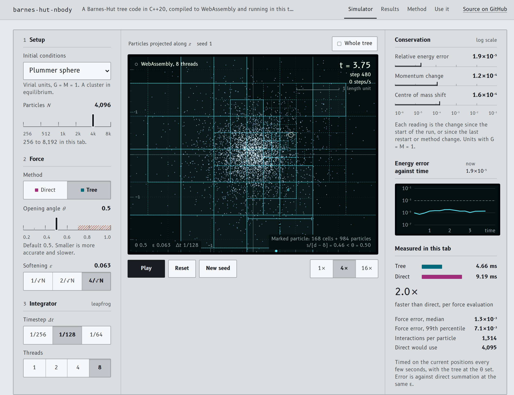
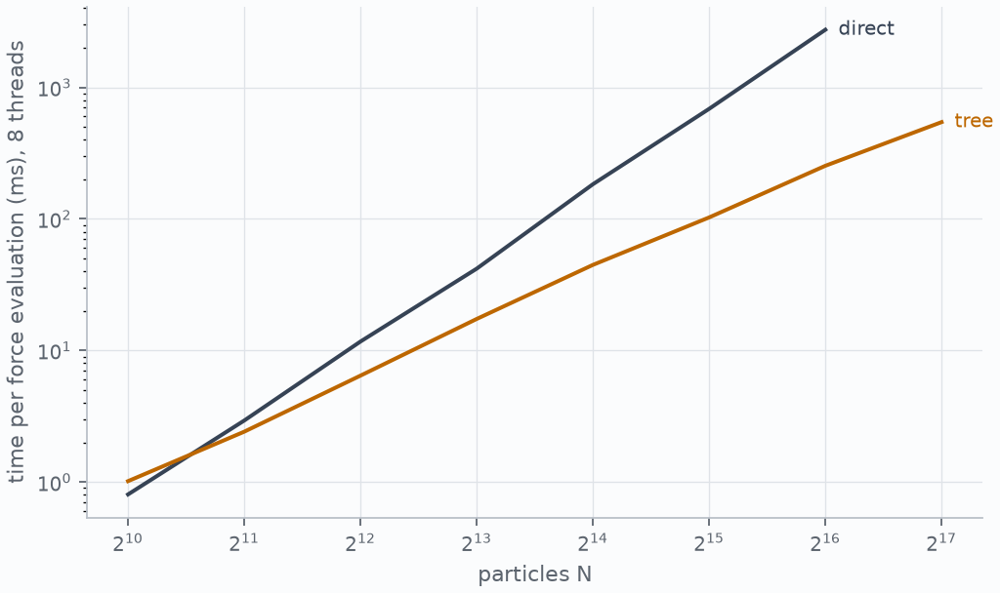
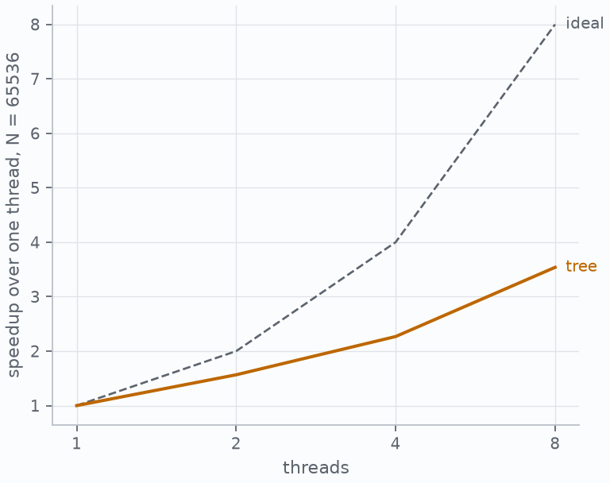

# barnes-hut-nbody

[](https://github.com/Protonicwave/barnes-hut-nbody/actions/workflows/ci.yml)

A gravitational N-body simulator in C++20 that uses a Barnes-Hut octree, runs its force loops on threads, and compiles to WebAssembly for the browser.

**Try it: https://barnes-hut-nbody.pages.dev/**

<picture>
  <source media="(prefers-color-scheme: dark)" srcset="docs/screenshots/hero-dark.png">
  
</picture>

## Method

Every particle attracts every other under Newtonian gravity with Plummer softening $`\epsilon`$, in units where $`G = 1`$. The acceleration of particle $`i`$ is

```math
\mathbf{a}_i = \sum_{j \neq i} \frac{m_j \,(\mathbf{r}_j - \mathbf{r}_i)}{\left(\lvert \mathbf{r}_j - \mathbf{r}_i \rvert^2 + \epsilon^2\right)^{3/2}}
```

Summing it directly takes $`N(N-1)`$ terms, so the cost grows as $`N^2`$.

The tree method groups distant particles. The particles go into an octree built in Morton order, and each cell stands in for its contents as one source of mass at their centre of mass. For a particle at distance $`d`$ from a cell of side $`s`$, the cell is used whole when

```math
d > \frac{s}{\theta} + \delta
```

where $`\delta`$ is the distance between the cell's centre of mass and its geometric centre (Barnes 1994). With $`\delta = 0`$ this is the familiar $`s/d < \theta`$. Otherwise the cell is opened and its children are tested in turn, down to leaves of at most 4 particles, which are summed pairwise. The opening angle $`\theta`$ sets the trade: 0 opens every cell and reproduces the direct sum, and values above about 0.7 are not recommended. For a bounded, roughly uniform distribution the expected cost is $`O(N \log N)`$.

Time stepping is kick-drift-kick leapfrog with a fixed timestep $`\Delta t`$:

```math
\begin{aligned}
\mathbf{v}_{n+1/2} &= \mathbf{v}_n + \tfrac{\Delta t}{2}\,\mathbf{a}_n \\
\mathbf{r}_{n+1} &= \mathbf{r}_n + \Delta t\,\mathbf{v}_{n+1/2} \\
\mathbf{v}_{n+1} &= \mathbf{v}_{n+1/2} + \tfrac{\Delta t}{2}\,\mathbf{a}_{n+1}
\end{aligned}
```

The scheme is symplectic and second order. The total energy is

```math
E = \sum_i \tfrac{1}{2} m_i v_i^2 \; - \sum_{i<j} \frac{m_i m_j}{\sqrt{r_{ij}^2 + \epsilon^2}}
```

and the potential is always summed directly, whichever method computed the forces, so the tree's error is measured against an exact reference. The energy error reported below is $`\lvert E(t) - E_0 \rvert / \lvert E_0 \rvert`$.

The test problem is a Plummer sphere in virial units, with $`M = G = 1`$ and $`E = -1/4`$, softened by $`\epsilon = 4/\sqrt{N}`$.

## Results

Medians of 5 repetitions on an Intel Core Ultra 5 238V (4 performance and 4 efficiency cores), g++ 16.2.0, 8 threads, $`\theta = 0.5`$. A tree evaluation includes building the tree.

| N | direct (ms) | tree (ms) |
|---:|---:|---:|
| 4096 | 11.7 | 6.4 |
| 16384 | 183.5 | 44.7 |
| 32768 | 686.3 | 102.6 |
| 65536 | 2739.0 | 253.4 |

The tree wins from N = 4096 and is 10.8 times faster at N = 65536. On that size the tree takes 896.8 ms on one thread and 253.4 ms on eight, a speedup of 3.5. The tree build is serial.

<picture>
  <source media="(prefers-color-scheme: dark)" srcset="results/speed-dark.png">
  
</picture>

<picture>
  <source media="(prefers-color-scheme: dark)" srcset="results/scaling-dark.png">
  
</picture>

The speed costs accuracy, set by $`\theta`$. At N = 16384 the median relative force error against direct summation is 3.0e-4 at $`\theta = 0.3`$, 1.0e-3 at 0.5, 2.3e-3 at 0.7 and 6.1e-3 at 1.0. At 0.5 the 99th percentile is 5.3e-3.

<picture>
  <source media="(prefers-color-scheme: dark)" srcset="results/force_error-dark.png">
  
</picture>

Over 28.25 time units, about ten crossing times, at N = 4096 with $`\Delta t = 1/128`$, the energy error of the tree at $`\theta = 0.5`$ stays below 8.2e-5. Direct summation at the same settings stays below 3.0e-6. The tree's error does not depend on the timestep: the opening angle sets it, while direct summation's falls with the square of $`\Delta t`$.

<picture>
  <source media="(prefers-color-scheme: dark)" srcset="results/energy_drift-dark.png">
  
</picture>

The same core compiles to WebAssembly. One tree force evaluation at N = 16384 takes 1.03 times as long as native on one thread and 1.01 times as long on eight, under Node 26.4.0.

Results are bitwise identical for every thread count, and between the single-threaded and threaded WebAssembly builds. The commands that produced each figure are in [docs/reproducing.md](docs/reproducing.md).

## Quick start

From Python:

```
pip install .
```

```python
import numpy as np
import barnes_hut as bh

positions, velocities, masses = bh.plummer_sphere(4096, seed=1)
simulation = bh.Simulation(
    positions, velocities, masses,
    dt=1 / 128, softening=4 / np.sqrt(4096),
    method="tree", theta=0.5, threads=8,
)
start = simulation.total_energy()
simulation.step(256)
print(simulation.time, abs(simulation.total_energy() - start) / abs(start))
```

From JavaScript, after building the WebAssembly module:

```js
import createModule from "./wasm/threads/nbody.js";

const module = await createModule();
const simulation = module.Simulation.create(
  "plummer", 4096, 1, "tree", 0.5, 4 / Math.sqrt(4096), 1 / 128, 8);
simulation.step(16);
const positions = simulation.positions(); // Float64Array view of 3 * N doubles
const error = Math.abs(simulation.energy() - simulation.initialEnergy())
  / Math.abs(simulation.initialEnergy());
```

## Documentation

- [docs/building.md](docs/building.md): building, the Python and WebAssembly interfaces, serving the page, deployment and the checks.
- [docs/reproducing.md](docs/reproducing.md): the commands behind every number and figure above.

## Licence

MIT. See `LICENSE`.
