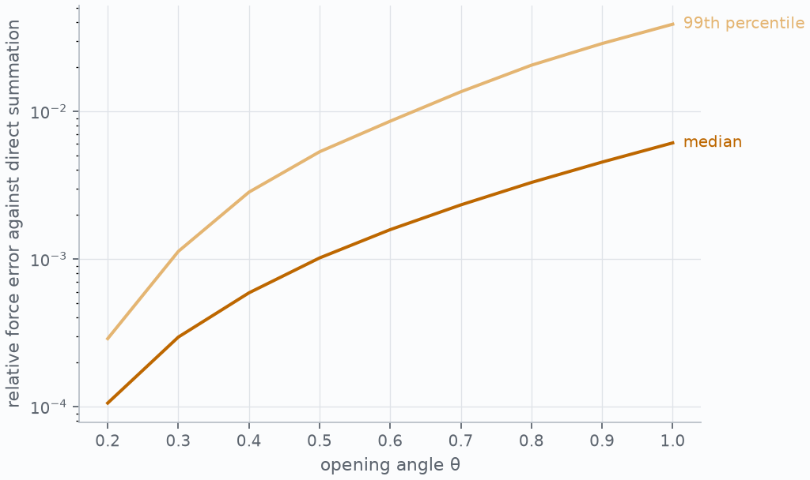
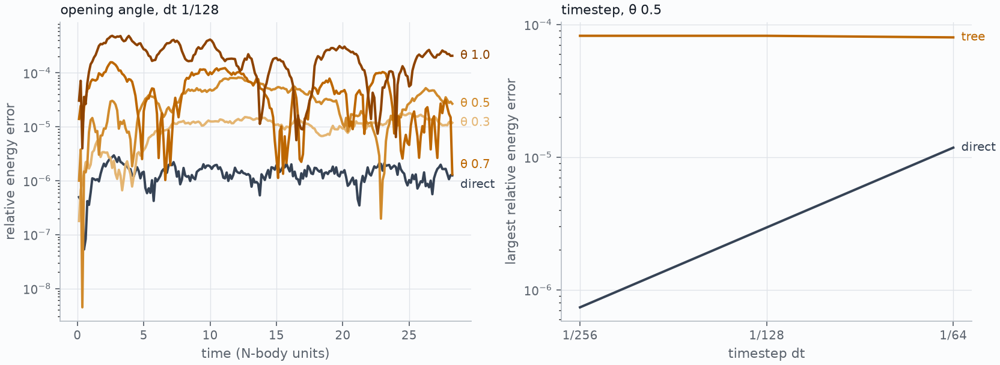

# barnes-hut-nbody

A gravitational N-body simulator in C++20. Forces come from direct
summation or a Barnes-Hut octree, both with Plummer softening, and time
stepping uses kick-drift-kick leapfrog with a fixed timestep. Force loops run
on OpenMP threads. A Python module wraps the library, and a WebAssembly build
is planned.

Units are N-body units with G = 1. The library provides:

- `compute_accelerations`: softened accelerations by direct summation or by a
  Morton-ordered octree with monopole cells. `ForceConfig::theta` sets the
  opening angle from 0 (exact, every cell opened) to 1. On a 4096-body
  Plummer sphere with softening 4/sqrt(N), the median relative force error
  against direct summation is 3.8e-4 at theta 0.3, 1.4e-3 at 0.5, 3.0e-3 at
  0.7 and 7.5e-3 at 1.0. Above about 0.7 is not recommended.
- `Simulation`: leapfrog stepping of a `ParticleSet`.
- `kinetic_energy`, `potential_energy`, `total_momentum`, `centre_of_mass`.
- `plummer_sphere`, `uniform_sphere` and `kepler_binary` initial conditions.

## Python

    pip install .

installs `barnes_hut` (Python 3.10 or later, NumPy 1.26 or later) and builds
the C++ core with CMake, Ninja and a C++20 compiler with OpenMP. Wheels for
Linux, Windows and macOS on Apple silicon are built by the `wheels` workflow.

```python
import numpy as np
import barnes_hut as bh

positions, velocities, masses = bh.plummer_sphere(4096, seed=1)
simulation = bh.Simulation(
    positions, velocities, masses,
    dt=1 / 128, softening=4 / np.sqrt(4096),
    method="tree", theta=0.5, threads=8,
)
start = simulation.total_energy()
simulation.step(256)
print(simulation.time, abs(simulation.total_energy() - start) / abs(start))
```

`method` is `"tree"` or `"direct"`; `theta` is from 0 to 1 and `threads` from 1
to 256. Invalid settings raise `ValueError` naming the value, and a particle
leaving the finite range raises `RuntimeError`. `positions`, `velocities` and
`masses` are read-only NumPy views of the simulation state, with no copy: they
follow `step`, and keep the simulation alive. The constructor copies its
inputs. `plummer_sphere`, `uniform_sphere` and `kepler_binary` return the
three arrays the constructor takes. `step` holds the Python interpreter lock
for the whole call, and a `Simulation` must not be used from two threads at
once. The tests run with `python -m pytest`, after `pip install ".[test,plot]"`.

## Build and test

Requires CMake 3.25 or later, Ninja and a C++20 compiler. Catch2 is fetched
at configure time.

    cmake --workflow --preset dev

The `release` preset builds optimised, `asan` runs the suite under
AddressSanitizer and UndefinedBehaviorSanitizer on Linux, and
`msvc` builds with Visual Studio's compiler from a developer prompt.

## Results

`ForceConfig::thread_count` sets the threads, from 1 to 256. Results are
bitwise identical for every thread count. Figures below are medians of 5
repetitions on an Intel Core Ultra 5 238V (4 performance and 4 efficiency
cores), g++ 16.2.0, `release` preset, Plummer sphere, softening 4/sqrt(N),
theta 0.5, 8 threads. A tree evaluation includes building the tree.

| N | direct (ms) | tree (ms) |
|---:|---:|---:|
| 4096 | 11.7 | 6.4 |
| 16384 | 183.5 | 44.7 |
| 32768 | 686.3 | 102.6 |
| 65536 | 2739.0 | 253.4 |

The tree at N = 65536 takes 896.8, 572.9, 395.4 and 253.4 ms on 1, 2, 4 and 8
threads. The tree build is serial. The full data is in `results/`:
`timing.json`, `force_error.csv` (force error quantiles against theta at
N = 16384) and `energy_drift.csv` (relative energy error every 1/8 time unit
for N = 4096 over 28.25 time units, about ten crossing times). The reference
run, tree at theta 0.5, timestep 1/128 and softening 4/sqrt(N), drifts by at
most 8.2e-5. Direct summation at the same settings drifts by at most 3.0e-6.

Reproduce them from the repository root:

    cmake --workflow --preset release
    build/release/bench/nbody_bench --benchmark_repetitions=5 --benchmark_min_time=0.1s --benchmark_report_aggregates_only=true --benchmark_out=build/release/budget.json --benchmark_out_format=json
    build/release/bench/accuracy_sweep force results/force_error.csv
    build/release/bench/accuracy_sweep drift results/energy_drift.csv
    python bench/check_budgets.py build/release/budget.json --drift results/energy_drift.csv --summary results/timing.json

`check_budgets.py` prints each budget beside its figure and exits 1 when any
is over. It reads the core count from `results/machine.txt`. Its tests run
with `python -m unittest discover -s bench`. The drift sweep takes about
eight minutes.

The figures below come from those files:





The tree's energy error does not depend on the timestep: it is set by the
opening angle, while direct summation's falls with the square of dt. Draw them
again with `python scripts/plot_results.py`, which needs the `plot` extra.

## Checks

    clang-tidy -quiet -p build/dev --extra-arg=--target=x86_64-w64-mingw32 src/*.cpp
    cppcheck -q --std=c++20 --enable=warning,style,performance,portability,unusedFunction --suppress=useStlAlgorithm --error-exitcode=1 -I include src tests bench
    ruff check python scripts
    mypy
    vulture python scripts --min-confidence 60
    cmake --workflow --preset coverage
    gcovr --root . --filter src/direct.cpp --filter src/octree.cpp --filter src/forces.cpp --filter src/simulation.cpp --filter src/diagnostics.cpp --exclude-throw-branches --exclude-unreachable-branches --exclude-noncode-lines --fail-under-line 100 --fail-under-branch 100 build/coverage

The `--target` flag matters only for a MinGW toolchain, where clang-tidy
must be told which one produced the compilation database.

## Licence

MIT. See `LICENSE`.
